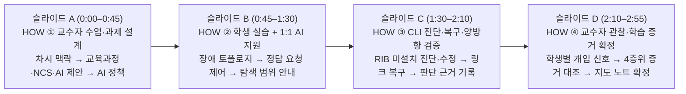
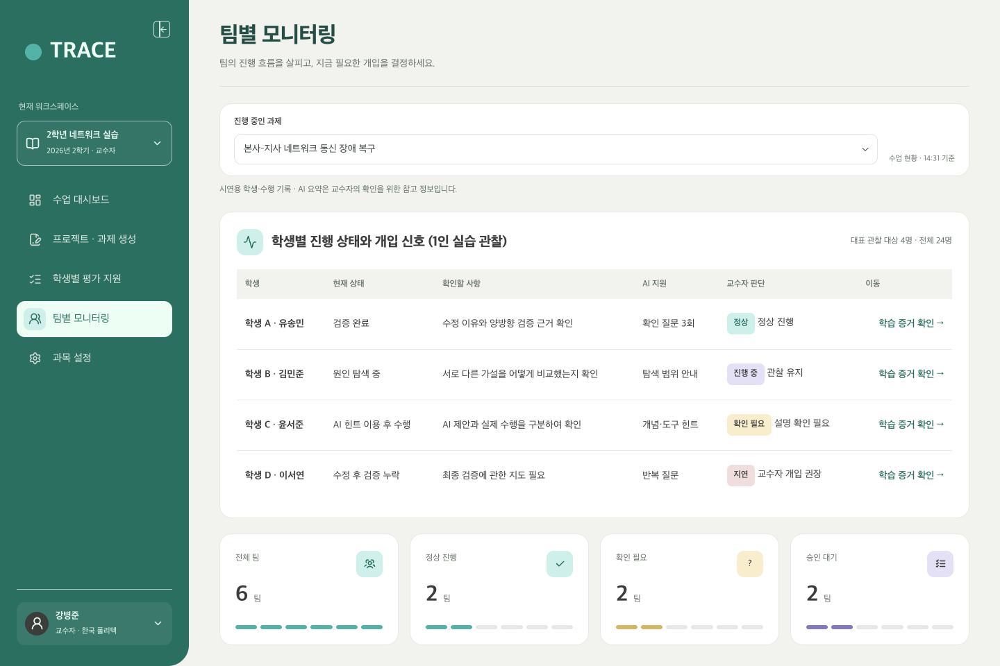
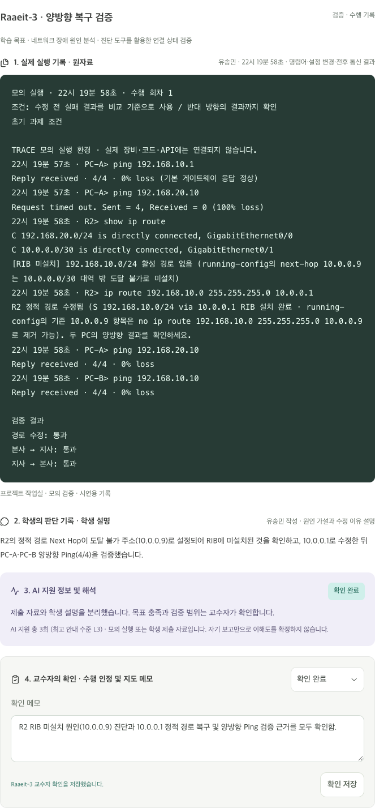

# TRACE 3분 학술발표 PPT 시연 구성 가이드 (애니메이션 확대 컷 · 설명 문구 · 발표 대본)

> [!IMPORTANT]
> **이미지 경로 및 PPT 애니메이션 활용 안내**
> 1. **저장소 상대 경로 적용 완료**: 모든 캡처 이미지를 [`docs/screenshots/demo/`](./screenshots/demo/) 폴더에 저장하고 상대 경로(`./screenshots/demo/...`)로 연결하여 Git/GitHub 및 로컬 마크다운 미리보기에서 정상 표시됩니다.
> 2. **PPT 클릭 애니메이션(`나타내기` / `확대`) 최적화**: 브라우저에서 직접 클릭하는 대신 PPT 슬라이드에서 과정과 화면 구성을 설명하실 수 있도록, 첨부해주신 발표자료(`05~08번 슬라이드: HOW ①~④`) 양식에 맞춰 **① 배경용 전체 화면(5장)**과 **② 클릭 애니메이션으로 하나씩 띄울 영역별 고해상도 확대 컷(11장)**으로 세분화했습니다.

---

## 슬라이드 A (`HOW ①`) — 교수자 수업 맥락 확인과 AI 과제·운영 정책 설계 (`0:00–0:45` · 45초)

### 1. 슬라이드 배경 (전체 화면)
| ① 수업 대시보드 전체 (`01-dashboard-full.png`) | ② AI 과제 설계 전체 (`02-assignment-full.png`) |
| :---: | :---: |
|  |  |

### 2. PPT 클릭 애니메이션 확대 컷 (`클릭 ① → ② → ③`)

#### [클릭 ①] 가상 수업 맥락과 차시 학습목표 (`01a-lesson-card-crop.png`)

- **무엇을 보여주는 영역인가 (PPT 콜아웃 문구)**:
  - **수업 맥락**: 직업계고 정보통신과 2학년 · `컴퓨터 네트워크` · **8주차(15/24차시) · 개인 실습**
  - **차시 연계**: 이전 수업(`라우터의 역할과 정적 라우팅`) → **이번 수업(`라우팅 장애 진단과 복구`)** → 다음 수업(`장애 원인 설명과 재발 방지`)

#### [클릭 ②] 교육과정·선택적 NCS 연계 및 AI 과제 제안 3단 구조 (`02a-triptych-crop.png`)

- **무엇을 보여주는 영역인가 (PPT 콜아웃 문구)**:
  - **① 교육적 요구사항**: 학생이 직접 수행할 4단계 행동(`장비 상태 확인 → 라우팅 테이블 비교 → 설정 수정 → 양방향 검증 및 이유 기록`) 명시
  - **② 근거자료 연결**: **2022 개정 교육과정 성취기준**을 기본으로 하고, **NCS 네트워크구축 직무 능력단위는 체크박스로 선택적 연계**
  - **③ AI의 과제 제안**: 조건에 맞춰 생성된 **‘본사–지사 네트워크 통신 장애 복구’** 시나리오를 교수자가 검토 후 적용

#### [클릭 ③] 교수자 승인형 AI 운영 정책과 가이던스 범위 (`02b-ai-policy-crop.png`)

- **무엇을 보여주는 영역인가 (PPT 콜아웃 문구)**:
  - **AI 운영 방식(`교수자 승인형 · 개입 보통`)**: 학생이 정답이나 명령어를 바로 요구할 때 정답 직접 제공을 제한하고 **`확인 질문` → `탐색 범위 안내` → `개념·도구 힌트`** 순으로 유도하도록 제어

### 3. 발표 대본 (`0:00–0:45`)
> “먼저 **HOW ① 교수자 수업 및 과제 설계** 단계입니다.  
> *(클릭 ①)* 시연 수업은 직업계고 정보통신과 2학년 컴퓨터 네트워크 과목의 8주차, 15차시 개인 실습인 **‘정적 라우팅 장애의 원인 분석과 복구’**입니다. 직전 차시에서 배운 정적 라우팅 개념을 바탕으로, 학생이 직접 통신 장애 증거를 수집하고 라우팅 테이블을 분석해 복구·검증하는 차시입니다.  
> *(클릭 ②)* 과제 설계 화면에서는 2022 개정 교육과정 성취기준과 교수자 교안을 기본 근거로 연결하고, **NCS 네트워크구축 능력단위는 수업 성격에 따라 선택적으로 연계**할 수 있습니다. 우측에서 AI가 이 조건들을 반영해 ‘본사–지사 통신 장애 복구’ 과제를 제안하면 교수자가 검토 후 적용합니다.  
> *(클릭 ③)* 이어서 AI 운영 방식을 **‘교수자 승인형’**으로 설정하여, AI가 정답 명령어를 바로 알려주지 않고 확인 질문과 탐색 범위 중심으로 지원하도록 기준을 확정합니다.”

---

## 슬라이드 B (`HOW ②`) — 학생 실습 토폴로지와 1:1 AI 단계적 지원 (`0:45–1:30` · 45초)

### 1. 슬라이드 배경 (전체 화면: 실습 작업실 + 우측 하단 1:1 AI 팝오버)

### 2. PPT 클릭 애니메이션 확대 컷 (`클릭 ① → ② → ③`)

#### [클릭 ①] Cisco Packet Tracer 스타일 본사–지사 장애 토폴로지 (`03a-topology-fault-crop.png`)

- **무엇을 보여주는 영역인가 (PPT 콜아웃 문구)**:
  - **실습 환경**: 본사(`PC-A` · `SW1` · `R1`, `192.168.10.0/24`)와 지사(`R2` · `SW2` · `PC-B`, `192.168.20.0/24`)가 WAN 직렬 구간(`10.0.0.0/30`)으로 연결된 구조
  - **초기 상태**: 정답 경로를 미리 노출하지 않고, 지사 라우터(`R2`) WAN 인터페이스의 주황색 경고 표시만으로 장애 상황을 제시

#### [클릭 ②] 1:1 AI 질문 1 — 정답·명령어 직접 요청 시 ‘확인 질문’으로 전환 (`03b-ai-popover-q1-crop.png`)

- **무엇을 보여주는 영역인가 (PPT 콜아웃 문구)**:
  - **학생 질문**: *“통신이 안 되는데 정답과 설정 명령어 알려주세요.”*
  - **TRACE AI 응답 (정답 제한 · 확인 질문)**: 교수자 정책에 따라 정답 명령어를 주는 대신, **PC-A에서 기본 게이트웨이(`192.168.10.1`)까지 통신이 되는지 먼저 확인**하도록 유도

#### [클릭 ③] 1:1 AI 질문 2 — 진단 결과 확인 후 ‘탐색 범위’ 안내 (`03c-ai-popover-q2-crop.png`)

- **무엇을 보여주는 영역인가 (PPT 콜아웃 문구)**:
  - **학생 질문**: 게이트웨이 Ping 성공 및 지사 단말 Ping 실패를 직접 확인한 뒤, *“R1과 R2 중 어느 장비의 라우팅 테이블을 먼저 확인할까요?”*로 질문이 구체화됨
  - **TRACE AI 응답 (탐색 범위 안내)**: 왕복 통신을 위해 **R1의 전달 경로(`192.168.20.0/24`)와 R2의 반환 경로(`192.168.10.0/24`) 및 Next Hop이 실제 WAN 대역(`10.0.0.0/30`)과 일치하는지 비교**하도록 안내

### 3. 발표 대본 (`0:45–1:30`)
> “다음은 **HOW ② 학생 실습과 1:1 AI 단계적 지원**입니다.  
> *(클릭 ①)* 학생의 실습 화면 상단에는 Cisco Packet Tracer 형태의 본사–지사 네트워크 토폴로지가 제시되며, 초기에는 오류 원인을 숨긴 채 통신 장애 상황만 부여합니다.  
> *(클릭 ②)* 학생이 화면 우측 하단의 **1:1 개인 AI 지원 창**을 열어 **‘정답과 설정 명령어를 알려달라’**고 요청하더라도, AI는 교수자가 설정한 정책에 따라 정답을 주지 않고 기본 게이트웨이까지 응답이 오는지 먼저 확인하도록 질문합니다.  
> *(클릭 ③)* 학생이 게이트웨이 응답을 직접 확인한 뒤 **‘어느 라우터의 라우팅 테이블을 먼저 볼지’** 다시 질문하면, AI는 왕복 통신의 요청 경로와 반환 경로를 비교하도록 탐색 범위를 좁혀 줍니다.”

---

## 슬라이드 C (`HOW ③`) — CLI 원인 진단 · 정적 경로 복구 · 양방향 검증 및 판단 기록 (`1:30–2:10` · 40초)

### 1. PPT 클릭 애니메이션 확대 컷 (`클릭 ① → ② → ③`)

#### [클릭 ①] R2 라우팅 테이블(RIB) 미설치 원인 확인 및 정적 경로 수정·양방향 Ping (`04a-cli-diagnosis-crop.png`)

- **무엇을 보여주는 영역인가 (PPT 콜아웃 문구)**:
  - **원인 진단 (`R2> show ip route`)**: `running-config`의 정적 경로 Next Hop이 `10.0.0.0/30` 대역 밖인 **`10.0.0.9`(도달 불가 주소)로 잘못 설정되어 실제 라우팅 테이블(RIB)에 미설치**된 상태임을 확인
  - **경로 복구 및 검증**: `ip route 192.168.10.0 255.255.255.0 10.0.0.1` 명령으로 올바른 Next Hop(`R1`의 `10.0.0.1`)을 설정하고, `PC-A → PC-B` 및 `PC-B → PC-A` 양방향 Ping(`4/4 · 0% loss`)을 모두 실행

#### [클릭 ②] 토폴로지 경로 복구 완료 상태 (`04b-topology-fixed-crop.png`)

- **무엇을 보여주는 영역인가 (PPT 콜아웃 문구)**:
  - **시각적 피드백**: R2의 정적 경로가 정상 설치되면 토폴로지의 R2 WAN 포트 표시등이 **녹색(정상)**으로 전환되고, 하단 검증 배지 3개(`수정 전 실패 비교`, `반대 방향 확인`, `양방향 통신 복구`)가 모두 완료 처리됨

#### [클릭 ③] 학생의 판단 근거와 수정 이유 직접 기록 (`04c-student-reflection-crop.png`)

- **무엇을 보여주는 영역인가 (PPT 콜아웃 문구)**:
  - **과정 증거 생성**: 단순 명령어 실행에 그치지 않고, **“왜 10.0.0.9가 오류였으며 어떻게 복구·검증했는지”** 학생이 자신의 언어로 서술해 제출함으로써 **실행 원자료 + 학생 설명**이 함께 보존됨

### 3. 발표 대본 (`1:30–2:10`)
> “이어서 **HOW ③ 학생의 CLI 진단과 복구, 판단 근거 기록** 과정입니다.  
> *(클릭 ①)* 학생은 지사 라우터 R2에서 `show ip route`를 실행해, 본사 대역으로 돌아가는 정적 경로의 Next Hop이 도달 불가능한 `10.0.0.9`로 설정되어 실제 라우팅 테이블(RIB)에 설치되지 않은 원인을 찾아냅니다. 이를 R1의 직렬 인터페이스 주소인 `10.0.0.1`로 수정한 뒤 PC-A와 PC-B 양방향 Ping을 모두 검증합니다.  
> *(클릭 ②)* 경로가 복구되면 상단 토폴로지의 모든 링크가 녹색 정상 상태로 전환됩니다.  
> *(클릭 ③)* 마지막으로 학생은 하단 기록란에 자신이 어떤 근거로 원인을 진단하고 수정했는지 직접 작성해 제출합니다.”

---

## 슬라이드 D (`HOW ④`) — 교수자 진행 관찰과 4층위 학습 증거(Learning Evidence) 확정 (`2:10–2:55` · 45초)

### 1. 슬라이드 배경 (전체 화면)
| ① 학생별 모니터링 전체 (`05-monitoring-full.png`) | ② 학생별 학습 증거 평가 전체 (`06-evaluation-full.png`) |
| :---: | :---: |
|  |  |

### 2. PPT 클릭 애니메이션 확대 컷 (`클릭 ① → ② → ③`)

#### [클릭 ①] 학생별 진행 상태와 교수자 개입 신호 표 (`05a-student-table-crop.png`)

- **무엇을 보여주는 영역인가 (PPT 콜아웃 문구)**:
  - **실시간 수업 관찰**: 1인 실습 중인 학생들의 상태를 **`검증 완료(정상)`**, **`원인 탐색 중(진행 중)`**, **`AI 힌트 이용 후 수행(확인 필요)`**, **`수정 후 검증 누락(교수자 개입 권장)`**으로 구분하여 누구에게 개입이 필요한지 즉시 파악

#### [클릭 ②] 4층위 학습 증거(원자료 · 학생 설명 · AI 해석 · 교수자 확인) 분리 검토 (`06a-evidence-4layers-crop.png`)

- **무엇을 보여주는 영역인가 (PPT 콜아웃 문구)**:
  - **1. 실제 실행 기록(원자료)**: 학생이 콘솔에서 실행한 Ping·`show ip route`·`ip route` 로그 원문
  - **2. 학생의 판단 기록**: 학생이 직접 작성한 원인 가설과 수정 이유
  - **3. AI 지원 정보 및 해석**: AI 지원 횟수·수준 요약 (자기 보고만으로 이해도를 확정하지 않도록 분리 표시)
  - **4. 교수자의 확인**: 교수자가 직접 **`근거 인정`**을 선택하고 확인 메모를 기록

#### [클릭 ③] AI 추천 지도 노트 검토 및 교수자 최종 평가 확정 (`06b-guidance-note-crop.png`)

- **무엇을 보여주는 영역인가 (PPT 콜아웃 문구)**:
  - **교수자 중심 평가 완결**: AI가 일방적으로 점수를 매기는 대신 **‘AI 추천 지도 노트 초안’**을 제안하고, 교수자가 이를 검토·반영해 **다음 차시 지도 계획으로 최종 저장**

### 3. 발표 대본 (`2:10–2:55`)
> “마지막으로 **HOW ④ 교수자의 진행 관찰과 학습 증거 확정** 단계입니다.  
> *(클릭 ①)* 교수자는 모니터링 화면에서 검증을 완료한 학생부터, AI 힌트 후 설명 확인이 필요한 학생, 수정 후 양방향 검증이 누락되어 교수자 개입이 필요한 학생까지 실시간 신호로 파악합니다.  
> *(클릭 ②)* 학생의 학습 증거 화면으로 이동하면, **① 실제 CLI 실행 원자료**, **② 학생의 판단 설명**, **③ AI 지원 이력**이 명확히 분리되어 제시되며, 교수자가 이를 대조해 **④ 근거 인정 여부**를 직접 결정합니다.  
> *(클릭 ③)* 끝으로 하단에서 AI가 제안한 지도 노트 초안을 검토하여 다음 차시 지도로 확정합니다. 이처럼 TRACE는 교수자의 수업 설계 의도가 AI 코칭과 학생 수행을 거쳐 다시 교수자의 증거 기반 평가로 연결되는 전 과정을 지원합니다.”
