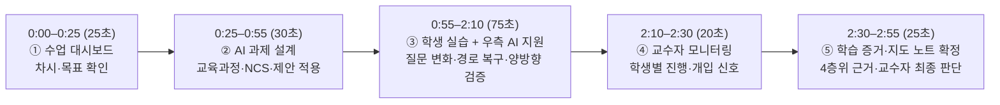

# TRACE 3분 시연 영상 촬영 가이드 및 발표 대본 (화면 캡처 포함)



---

## 장면 ① [0:00–0:25] 교수자 — 수업 선택 (`수업 대시보드`)


### 조작 경로
1. 첫 진입 화면(`수업 대시보드`)에서 상단 **`정적 라우팅 장애의 원인 분석과 복구`** 카드(`8주차 · 15/24차시 · 개인 실습`, 선수학습·이번 목표·이전/이번/다음 차시 흐름)를 마우스 커서로 짚어줍니다.
2. 우측 상단 녹색 버튼 **「이번 차시 과제 설계」**를 클릭합니다.

### 발표 대본 (0:00–0:25 · 약 25초)
> “교수자가 TRACE에 접속하면 먼저 담당 수업의 진도와 차시 흐름을 확인합니다.  
> 이번 시연 수업은 직업계고 정보통신과 2학년 컴퓨터 네트워크 과목의 8주차, 15차시 개인 실습인 **‘정적 라우팅 장애의 원인 분석과 복구’**입니다.  
> 직전 차시에서 배운 정적 라우팅 개념을 바탕으로, 이번 시간에는 학생이 직접 장애 증거를 수집하고 라우팅 테이블을 분석해 복구·검증하는 것이 목표입니다. 바로 **‘이번 차시 과제 설계’**로 이동하겠습니다.”

---

## 장면 ② [0:25–0:55] 교수자 — AI 과제 생성·확정 (`과제 생성`)


### 조작 경로
1. 상단 3단 요약 카드([`AssignmentProposalPanel.tsx`](file:///Users/songwoo/workspace/trace-demo-2026/src/features/teacher/AssignmentProposalPanel.tsx))에서 **① 교육적 요구사항**과 **② 근거자료 연결**의 **`NCS 네트워크구축 직무 능력단위 선택적 연계`** 체크박스를 확인합니다.
2. **③ AI의 과제 제안** 카드(`과제 제안: 본사–지사 네트워크 통신 장애 복구`) 하단의 **「AI 제안 과제 적용」** 버튼을 클릭합니다.
3. (시간 여유 시) 상단 단계 탭 **「2 AI 운영 방식 설정」**을 눌러 `교수자 승인형`·`정답 직접 제공 제한` 정책을 짧게 보여준 뒤, 좌측 하단 **「프로필 전환」 → `유송민 학생`**을 클릭합니다.

### 발표 대본 (0:25–0:55 · 약 30초)
> “과제 설계 화면에서는 차시 목표와 학생이 직접 수행해야 할 행동, 그리고 2022 개정 교육과정 성취기준과 교안을 연결합니다. 이때 NCS 네트워크구축 능력단위는 교수자가 수업 성격에 맞게 선택적으로 연계할 수 있습니다.  
> 우측에서 AI가 이 조건들을 반영해 **‘본사–지사 네트워크 통신 장애 복구’** 과제를 제안하며, 교수자가 **‘AI 제안 과제 적용’**을 눌러 과제를 확정하고 정답 직접 제공을 제한하는 AI 코칭 정책을 설정합니다.”

---

## 장면 ③-A [0:55–1:35] 학생 — 정답 요청에서 탐색 질문으로 변화 (`프로젝트 작업실 → 실행 및 검증`)


### 조작 경로
1. `유송민 학생` 전환 후 좌측 메뉴 **「프로젝트 작업실」** → 상단 탭 **「실행 및 검증」** 클릭
2. 좌측 `검증 조건` 체크박스 2개 모두 체크:
   - `[v] 수정 전 실패 결과를 비교 기준으로 사용`
   - `[v] 반대 방향의 결과까지 확인`
3. **우측 하단 플로팅 버튼 `1:1 AI` 클릭** → 채널톡 스타일 **`개인 AI 지원` 팝오버 창** 오픈:
   - 팝오버 하단 `자주 묻는 질문` 중 첫 번째 **`통신이 안 되는데 정답과 설정 명령어 알려주세요.`** 클릭
   - → AI가 정답 명령어를 주지 않고 *“기본 게이트웨이(192.168.10.1)까지 통신이 가능한지 확인해 보세요.”*라고 안내하는 응답 확인
4. **좌측 CLI 단축 버튼**에서 **`ping 192.168.10.1`** 클릭(성공 `4/4`) → **`ping 192.168.20.10`** 클릭(실패 `100% loss`)
5. **우측 하단 `개인 AI 지원` 팝오버 창**에서 두 번째 **`R1과 R2 중 어느 장비의 라우팅 테이블을 먼저 확인할까요?`** 클릭:
   - → AI가 요청 경로와 반환 경로(`R1`·`R2`의 `show ip route`)를 비교하도록 안내하는 응답 확인 후, 우측 하단 원형 **`X` 버튼**을 눌러 팝오버를 닫습니다.

### 발표 대본 (0:55–1:35 · 약 40초)
> “이제 학생 화면의 실습 작업실입니다. 상단에는 Cisco Packet Tracer 형태의 본사–지사 네트워크 토폴로지가 제시되며, 초기에는 잘못된 경로를 숨기고 통신 장애 상태만 보여줍니다.  
> 학생이 우측 **개인 AI 지원 창**에 **‘통신이 안 되는데 정답과 설정 명령어를 알려달라’**고 요청하더라도, AI는 교수자 정책에 따라 정답을 바로 주지 않고 기본 게이트웨이까지 Ping을 먼저 확인하도록 유도합니다.  
> 학생이 좌측 콘솔에서 게이트웨이 응답을 확인한 뒤 **‘어느 장비의 라우팅 테이블을 먼저 확인할지’** 다시 질문하면, AI는 왕복 통신을 위한 요청·반환 경로 비교 범위를 안내합니다.”

---

## 장면 ③-B [1:35–2:10] 학생 — R2 경로 복구·양방향 검증·판단 근거 기록


### 조작 경로
1. 토폴로지에서 **`R2 (지사)` 아이콘 클릭**(또는 실행 대상 `R2` 선택) → 단축 버튼 **`show ip route`** 클릭 (`10.0.0.9` 도달 불가로 인한 `[RIB 미설치]` 확인)
2. `명령·요청` 입력창에 아래 명령어를 붙여넣고 **「실행」** 클릭:
   ```text
   ip route 192.168.10.0 255.255.255.0 10.0.0.1
   ```
   *(필요 시 `no ip route 192.168.10.0 255.255.255.0 10.0.0.9`를 먼저 실행해도 동일하게 동작합니다.)*
3. 토폴로지에서 **`PC-A` 클릭** → 단축 버튼 **`ping 192.168.20.10`** 클릭 (`4/4` 성공)
4. 토폴로지에서 **`PC-B` 클릭** → 단축 버튼 **`ping 192.168.10.10`** 클릭 (`4/4` 성공 · 하단 배지 3개 모두 `확인 완료`로 변경)
5. 하단 `수행자료와 검증 기록` 입력창에 아래 문구를 붙여넣고 **「검증 근거 팀에 공유」** 클릭:
   ```text
   R2의 정적 경로 Next Hop이 도달 불가 주소(10.0.0.9)로 설정되어 RIB에 미설치된 것을 확인하고 10.0.0.1로 수정 후 PC-A·PC-B 양방향 Ping을 검증했습니다.
   ```

### 발표 대본 (1:35–2:10 · 약 35초)
> “학생은 지사 라우터 R2를 선택해 라우팅 테이블을 조회하고, 본사 대역 반환 경로의 Next Hop이 도달 불가능한 `10.0.0.9`로 잘못 설정된 것을 찾아냅니다.  
> 이를 R1의 직렬 인터페이스 주소인 `10.0.0.1`로 수정하면 토폴로지 링크가 정상 복구됩니다. 이어서 PC-A와 PC-B 양방향 Ping을 모두 검증한 뒤, 왜 해당 설정을 변경했는지 자신의 판단 근거를 기록해 제출합니다.”

---

## 장면 ④ [2:10–2:30] 교수자 — 진행 관찰과 개입 (`팀별 모니터링`)


### 조작 경로
1. 좌측 하단 **「프로필 전환」 → `강병준 교수자`** 클릭 → 좌측 메뉴 **「팀별 모니터링」** 클릭
2. 상단 **`학생별 진행 상태와 개입 신호 (1인 실습 관찰)`** 표에서 학생 A~D의 상태(`검증 완료`, `원인 탐색 중`, `AI 힌트 이용 후 수행`, `수정 후 검증 누락`)를 확인합니다.
3. 첫 번째 행(`학생 A · 유송민`) 우측의 **「학습 증거 확인 →」** 버튼을 클릭합니다.

### 발표 대본 (2:10–2:30 · 약 20초)
> “교수자가 모니터링 화면으로 돌아오면 학생별 진행 상황과 개입 신호를 한눈에 파악할 수 있습니다.  
> 검증을 마친 학생 A부터, 원인 탐색 중인 학생 B, AI 힌트 후 수행 중인 학생 C, 수정 후 검증이 누락되어 개입이 필요한 학생 D까지 구분해 확인하고, 학생 A의 **‘학습 증거 확인’**으로 이동합니다.”

---

## 장면 ⑤ [2:30–2:55] 교수자 — 학습 증거 검토·지도 노트 확정 (`학생별 평가 지원`)


### 조작 경로
1. 우측 패널에서 **1. 실제 실행 기록(원자료) → 2. 학생의 판단 기록 → 3. AI 지원 정보 및 해석 → 4. 교수자의 확인(`근거 인정`)** 4층위 구조를 짚어줍니다.
2. 하단 `교수자 피드백 및 다음 지도 노트 확정` 섹션에서 **「AI 추천 지도 노트 적용」** 버튼을 클릭해 지도 노트를 채운 뒤, 우측 하단 **「평가 저장」** 버튼을 클릭합니다.

### 발표 대본 (2:30–2:55 · 약 25초)
> “마지막 평가 지원 화면은 AI가 점수를 매기는 대신, 학생이 입력한 **실제 CLI 실행 원자료**, **학생의 판단 설명**, **AI 질문·힌트 이력**을 분리해 보여줍니다.  
> 교수자는 이 근거를 바탕으로 성취기준 달성 여부를 직접 인정하고, AI가 초안을 제안한 개별 지도 노트를 검토·확정하여 다음 수업 지도로 연결합니다. 이상으로 TRACE 시연을 마치겠습니다.”
