# TRACE 플랫폼 작동 시연 가이드 (PPT 삽입용 이미지·GIF·발표 대본)

발표 중 **네트워크 실습을 예시로 실제 플랫폼(시스템)이 어떻게 작동하는지 보여주는 시연 파트** 자료입니다.  
각 단계별로 **누가 · 어떤 상황에서 · 플랫폼에 무엇을 넣고 어떻게 활용하는지** 순서대로 구성되어 있습니다.

---

## 시연 파트 4단계 요약

| 단계 | 주체 | 플랫폼 작동 핵심 | 사용 시각 자료 |
| :--- | :--- | :--- | :--- |
| **STEP 1** | **교수자** (수업 준비) | 미리 설계된 **과제 양식·수업 시나리오**와 교육과정 자료를 넣으면, AI가 이를 **과제 명세로 구조화**해 보여주고 교수자가 검토·확정함 *(상황 주입형 과제 / 일반 과제 지원)* | `gif-01-teacher-design.gif` `02a`, `02b` |
| **STEP 2** | **학생** (과제 수행) | 실습 중 막혀서 AI에게 **"그냥 해줘(정답 요구)"** 라고 해도 이를 차단하고, **교육 목표를 달성할 수 있는 점검 순서와 방향**으로 유도함 | `gif-02a-ai-popover-closeup.gif` `gif-03-student-cli-recovery.gif` `03b0`, `03b`, `03c`, `04c` |
| **STEP 3** | **교수자** (수업 중) | 학생들의 **실시간 수행 상태와 AI 도움 요청 빈도**를 확인하며, 그 상태를 토대로 **수업 난이도(AI 힌트 허용 범위)를 조절**함 | `05a`, `02b` |
| **STEP 4** | **교수자** (평가·지도) | 수행 이후 축적된 **정량적 학습 증거(실행 기록·판단 이유·AI 도움 횟수/수준)** 를 평가 근거로 삼고, **학생 개인별 맞춤 지도 자료**로 활용함 | `gif-04-teacher-evidence-review.gif` `06a1`, `06a2`, `06b` |

---

## STEP 1. [교수자] 사전 설계 양식·시나리오 투입 및 과제 생성

### 핵심 포인트 (슬라이드 설명 기준)
- **사전 설계 양식 기반 구조화**: 교수자가 막연하게 "아무 과제나 만들어달라"고 요청하는 방식이 아닙니다. 교수자가 **미리 설계된 과제 양식(템플릿)과 국가 교육과정·NCS 자료**를 넣으면(혹은 수업 시나리오를 넣고 교수자가 사전 검토를 거치면), AI가 이를 **학생 배포용 과제 안내문, 단계별 수행 조건, 평가 기준**으로 구조화하여 보여줍니다.
- **과제 유형 구분 (상황 주입형 vs 일반 과제)**:
  - **상황 주입형 실습 과제**: 이번 네트워크 예시처럼 실습 환경에 의도된 오류·문제 상황을 미리 주입해 두고, 학생이 원인을 찾아 해결하게 하는 과제입니다. (주입한 문제 정답 기준은 교수자 화면에만 표시되고 학생 안내문에서는 자동 분리됩니다.)
  - **일반 과제**: 별도의 오류 주입 없이 개념 탐색, 보고서·산출물 양식 작성, 개인·팀 프로젝트를 수행하는 일반 과제도 동일하게 생성할 수 있습니다.

### 🎤 발표 대본
> "먼저 교수자가 수업을 준비하며 과제를 만드는 화면입니다.  
> 교수자가 미리 설계된 과제 양식과 교육과정·NCS 기준 자료를 플랫폼에 넣으면, AI가 이를 바탕으로 학생에게 안내할 과제 설명과 수행 조건을 구조화해서 보여줍니다. 시나리오만 넣는 경우에도 교수자가 생성된 과제와 정답 기준을 반드시 사전 검토한 뒤 확정하도록 설계되어 있습니다.  
> 또한 과제 성격에 따라 일반 보고서·산출물 중심의 **일반 과제**를 낼 수도 있고, 지금 보시는 네트워크 실습 예시처럼 실습 환경에 특정 문제 상황을 미리 심어두는 **상황 주입형 과제**를 선택할 수도 있습니다.  
> 과제를 확정한 뒤에는, 학생이 수행 과정에서 AI에게 정답만 바로 얻어가지 못하도록 AI가 어느 수준까지 힌트를 줄지 지원 범위를 설정합니다."

### 🎬 동작 화면 GIF (`gif-01-teacher-design.gif`)
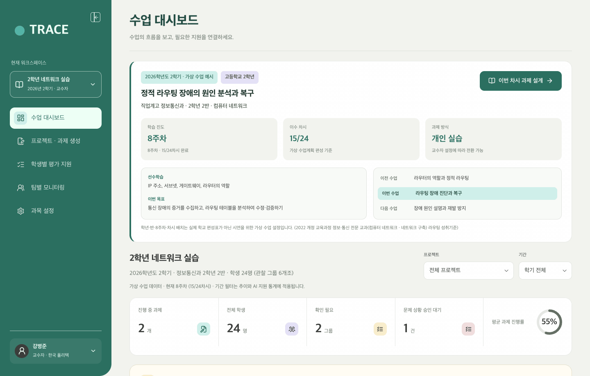

### 🖼️ 슬라이드 삽입용 확대 이미지

| ① 과제 유형(상황 주입형/일반) 및 사전 설계 양식 투입 (`02a`) | ② AI 지원 범위 및 가이드 단계 설정 (`02b`) |
| :---: | :---: |
| 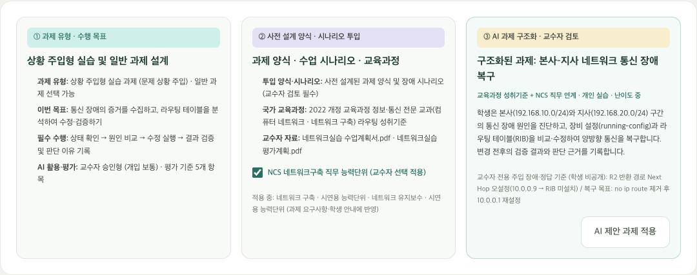 | 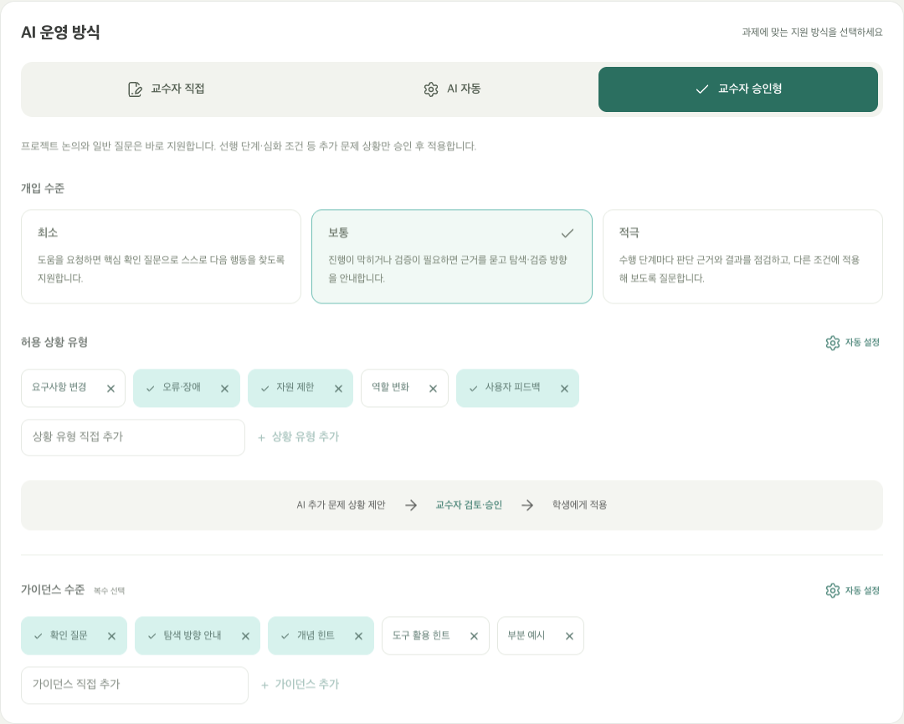 |
| 사전 설계된 과제 양식·시나리오 투입 후 교수자 검토를 거쳐 과제 적용 (학생 안내와 교수자용 정답 자동 분리) | 확인 질문 · 탐색 방향 안내 · 개념 힌트 · 도구 활용 힌트 4단계 설정 |

---

## STEP 2. [학생] '막 해줘' 방지 및 교육 목표 달성 방향 유도

### 핵심 포인트 (슬라이드 설명 기준)
- **무분별한 정답 요구 차단**: 학생이 실습 도중 막혀서 우측 하단 1:1 AI 지원 창에 *"잘 안 되는데 정답 알려줘"* 라고 요청해도, AI는 정답이나 해결 명령어를 바로 제시하지 않습니다.
- **교육 목표 달성 유도**: 대신 교수자가 설정한 교육 목표를 달성할 수 있도록 *"어느 구간부터 먼저 확인해 볼까요?"* 와 같이 점검 순서와 생각할 거리를 단계별로 질문합니다.
- **직접 검증 및 이유 기록**: 학생은 AI가 유도한 방향을 따라 실습 도구에서 직접 문제를 해결·검증하고, 본인이 왜 그렇게 판단했는지 이유를 작성해 제출합니다.

### 🎤 발표 대본
> "다음은 이 과제를 수행하는 학생의 화면입니다.  
> 학생이 실습을 진행하다 막히면 우측 하단에 있는 1:1 개인 AI 지원 창을 열어 도움을 요청할 수 있습니다. 이때 학생이 '그냥 정답을 알려달라'고 요구하더라도, 플랫폼의 AI는 정답을 바로 알려주지 않습니다.  
> 대신 잠시 학생의 현재 실습 상태를 확인한 뒤, 이번 수업의 교육 목표를 달성할 수 있도록 무엇부터 차례대로 점검해야 하는지 탐색 방향을 질문하며 유도합니다.  
> 학생은 이 가이드를 따라 직접 실습 도구를 조작해 문제를 해결하고, 마지막에는 자신이 어떤 근거로 문제를 해결했는지 판단 이유를 직접 기록해야 과제가 마무리됩니다."

### 🎬 동작 화면 GIF (`gif-02a`, `gif-03`)

| ① 1:1 AI가 정답 요구를 막고 탐색 방향을 유도하는 장면 (`gif-02a`) | ② 학생이 가이드를 따라 직접 실습 도구를 조작·검증하는 장면 (`gif-03`) |
| :---: | :---: |
| 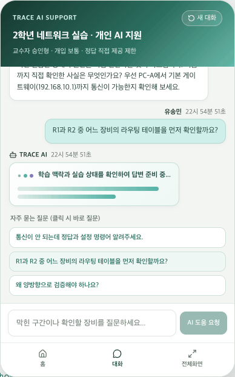 | 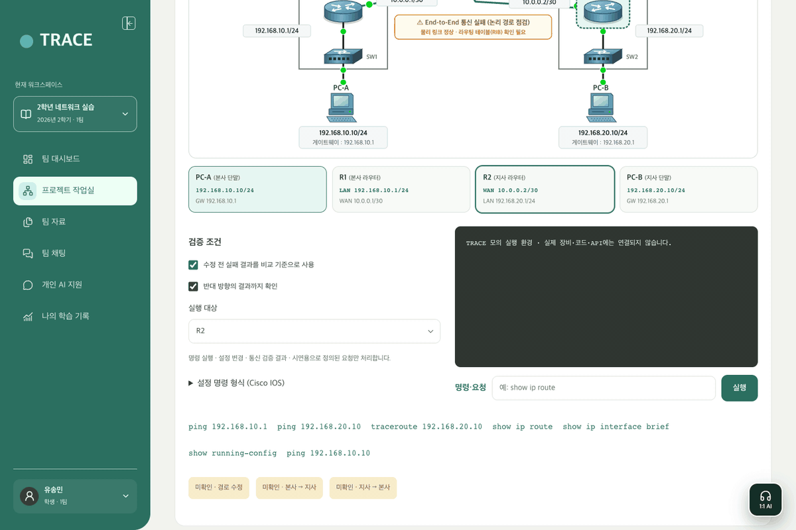 |

### 🖼️ 슬라이드 삽입용 확대 이미지

| ① 실습 맥락 확인 대기 (`03b0`) | ② 1차 유도: 점검 순서 질문 (`03b`) | ③ 2차 유도: 원인 탐색 질문 (`03c`) |
| :---: | :---: | :---: |
| 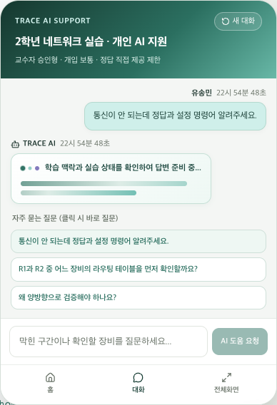 | 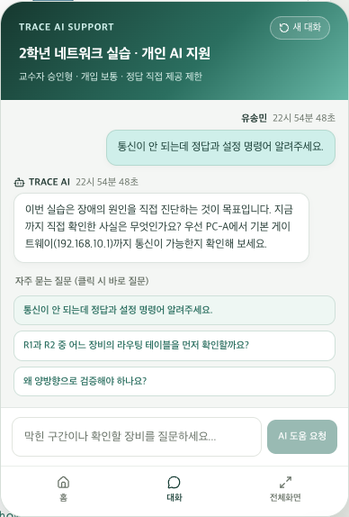 | 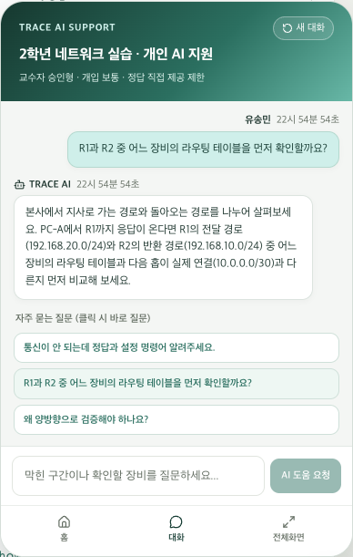 |
| 질문 직후 학생의 실습 상태를 확인하는 상태 표시 | 정답 제시 대신 첫 번째 점검 순서를 스스로 생각하게 유도 | 학생이 확인한 결과를 바탕으로 다음 점검 지점 유도 |

#### ④ 학생이 직접 검증을 마친 뒤 자신의 판단 근거를 기록하는 화면 (`04c`)
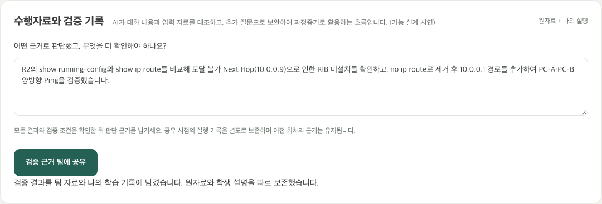

---

## STEP 3. [교수자] 수행 상태 확인 및 실시간 난이도 조절

### 핵심 포인트 (슬라이드 설명 기준)
- **수행 상태 실시간 파악**: 학생들이 과제를 수행하는 동안, 교수자는 모니터링 표에서 학생별 진행 단계(진단 전, 원인 분석 중, 검증 완료 등)와 AI 개입 신호(질문 횟수·힌트 단계)를 실시간으로 확인합니다.
- **수행 상태 기반 난이도 조절**: 학생들이 특정 단계에서 과도하게 막혀 있거나 반대로 너무 쉽게 해결하는 경우, 교수자는 이 수행 상태를 바탕으로 AI가 허용하는 힌트 단계나 개입 수준을 조정해 수업 난이도를 유연하게 조절합니다.

### 🎤 발표 대본
> "학생들이 과제를 수행하는 동안, 교수자는 모니터링 화면에서 각 학생이 어느 단계에 머물러 있는지, 그리고 AI에게 몇 번이나 도움을 요청했는지를 실시간으로 확인합니다.  
> 만약 다수의 학생이 특정 구간에서 계속 막혀 있거나 반대로 너무 쉽게 넘어간다면, 교수자는 이 수행 상태를 토대로 AI가 제공하는 힌트의 허용 범위를 넓히거나 좁혀서 과제 난이도를 상황에 맞게 조절할 수 있습니다."

### 🖼️ 슬라이드 삽입용 확대 이미지

#### ① 학생별 실시간 수행 상태 및 AI 개입 신호 관찰 표 (`05a`)
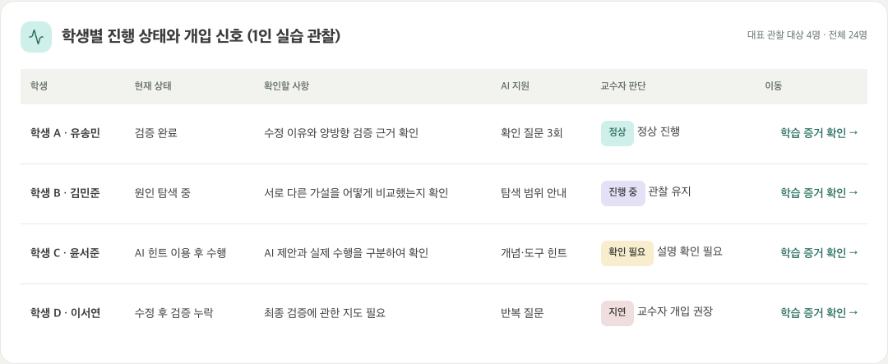

#### ② 수행 상태에 따라 교수자가 힌트 허용 범위(난이도)를 조절하는 화면 (`02b`)

---

## STEP 4. [교수자] 정량적 학습 증거 기반 평가 및 개인 맞춤 지도 활용

### 핵심 포인트 (슬라이드 설명 기준)
- **정량적·과정적 학습 증거 통합**: 실습 종료 후 교수자는 최종 결과물 하나만 보고 채점하지 않고, 플랫폼에 자동 기록된 **① 실제 실습 실행 기록(시도 횟수·성공 여부), ② 학생이 작성한 판단 이유, ③ 정량적 AI 활용 지표(질문 횟수·제공된 힌트 단계)** 를 근거로 평가합니다.
- **학생 개인 지도 자료 활용**: 수집된 학습 증거를 바탕으로 **AI 추천 지도 노트**가 생성되어, 교수자가 각 학생의 취약 지점을 짚어주는 **개인별 맞춤 지도 자료**로 즉시 활용할 수 있습니다.

### 🎤 발표 대본
> "마지막으로 과제 수행이 끝난 뒤 교수자의 평가 및 지도 화면입니다.  
> 교수자는 최종 제출물 하나만으로 평가하지 않고, 수행 과정에서 자동으로 기록된 정량적 증거들을 함께 확인합니다. 학생이 실제로 몇 번 시도해 어떻게 검증했는지 보여주는 실행 원자료, 학생 본인이 작성한 판단 이유, 그리고 AI 도움을 총 몇 회, 어느 단계까지 받았는지에 대한 정량 지표를 종합해 공정한 평가의 근거로 삼습니다.  
> 또한 이 기록을 바탕으로 학생마다 어느 부분에서 막혔고 다음에 무엇을 보완해야 하는지 정리된 지도 노트가 생성되어, 학생 개인별 맞춤 지도 자료로 바로 활용할 수 있습니다."

### 🎬 동작 화면 GIF (`gif-04-teacher-evidence-review.gif`)
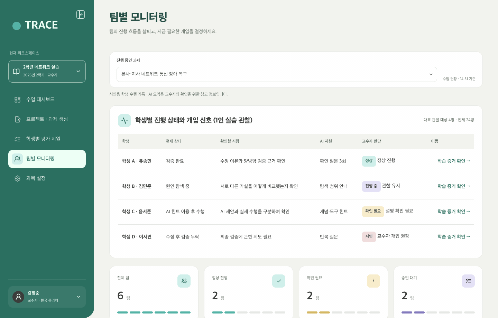

### 🖼️ 슬라이드 삽입용 확대 이미지

| ① 학생 수행 증거: 실제 실행 기록 + 학생 판단 이유 (`06a1`) | ② 정량적 AI 지원 지표 요약 + 교수자 평가 확인 (`06a2`) |
| :---: | :---: |
| 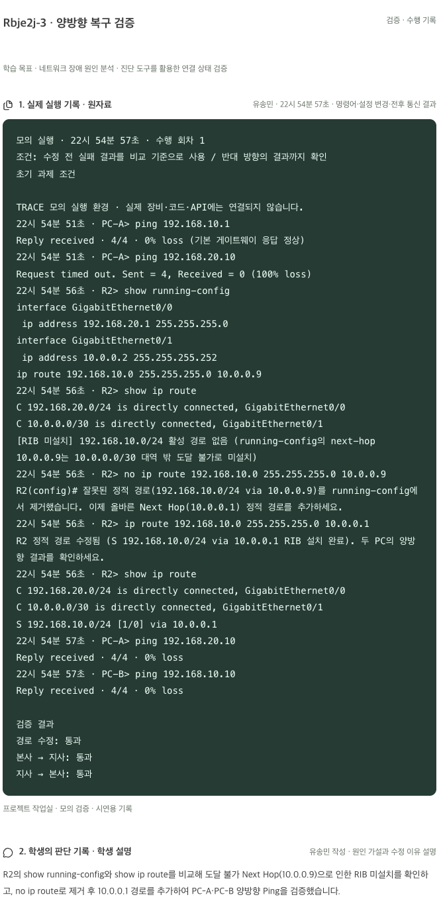 | 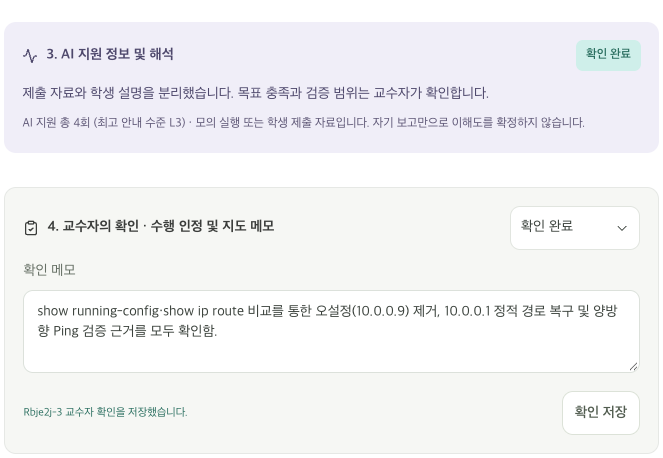 |
| 학생이 실습 도구에서 수행한 전체 실행 기록과 직접 작성한 판단 이유 | **질문 2회 · 탐색 방향 안내** 등 정량적 AI 활용 지표와 교수자 확인 메모 |

#### ③ 학생 개인별 맞춤 지도 자료로 활용하는 지도 노트 (`06b`)
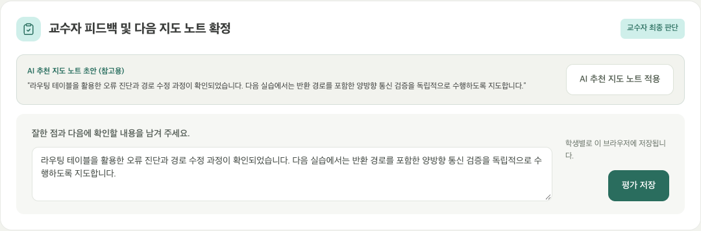

---

## 부록 1. 배포 사이트 QR코드 (`https://learning.aihous.site/`)

PPT 마지막 장이나 현장 부스 안내판에 배치할 수 있는 실제 배포 사이트 접속 QR코드입니다.

| PPT 엔딩·부스 안내판용 배너 카드 (`qr-card-learning-aihous-site.png`) | 단독 정사각형 QR코드 (`qr-learning-aihous-site.png`) |
| :---: | :---: |
| 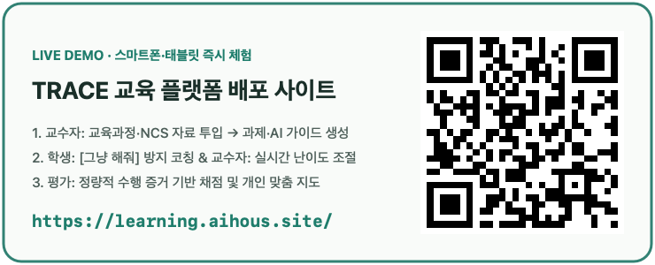 |  |
| [배너 카드 원본 열기](./screenshots/demo/qr-card-learning-aihous-site.png) | [PNG 원본](./screenshots/demo/qr-learning-aihous-site.png) · [SVG 벡터 원본](./screenshots/demo/qr-learning-aihous-site.svg) |

---

## 부록 2. 질의응답(Q&A) 핵심 답변 가이드

| 예상 질문 | 답변 요지 |
| :--- | :--- |
| **Q1. AI가 과제를 자동으로 만들면 수업 의도와 다른 문제가 나올 위험은 없나요?** | 교수자가 백지상태에서 AI에게 문제 출제를 맡기는 것이 아니라, **사전에 설계된 과제 양식(템플릿)과 수업 시나리오**를 넣으면 AI가 이를 학생 안내용 명세와 검증 단계로 구조화해 주는 방식입니다. 특히 문제 상황을 주입하는 실습 과제의 경우 **교수자가 주입 조건과 정답 기준을 사전 검토·승인**한 뒤에만 배포됩니다. |
| **Q2. 화면에 나온 네트워크 실습 외에 다른 수업이나 일반 과제에도 쓸 수 있나요?** | 네, 이번 시연의 네트워크 실습은 플랫폼 작동을 보여드리기 위한 하나의 예시일 뿐입니다. 실습 환경에 오류를 심어두는 **상황 주입형 과제**뿐 아니라, 일반 전공 이론·보고서·산출물 양식을 제출하는 **일반 과제**도 동일하게 지원하도록 설계되어 있습니다. |
| **Q3. 평가에 사용하는 정량적 증거에는 구체적으로 무엇이 포함되나요?** | ① 실습 도구에서의 **실제 실행 시도 횟수 및 전후 검증 통과 여부**, ② **AI에게 도움을 요청한 횟수와 사용된 힌트 단계(1~4단계 분포)**, ③ 학생이 직접 서술한 **판단 근거** 세 가지가 함께 기록됩니다. 이를 통해 결과물만 제출했을 때 알 수 없던 수행 과정을 객관적으로 평가하고 개인 지도 자료로 활용할 수 있습니다. |
