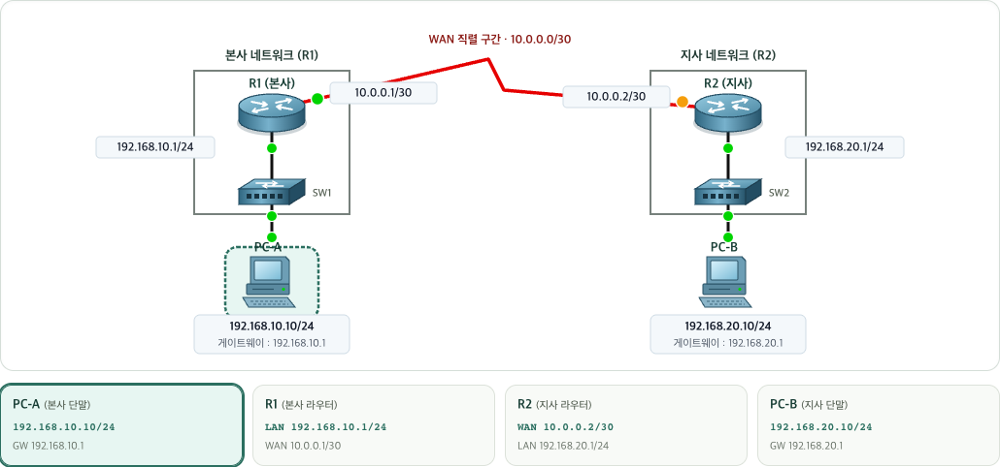
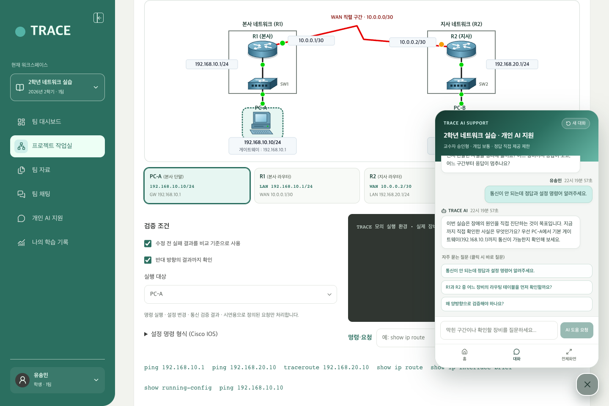
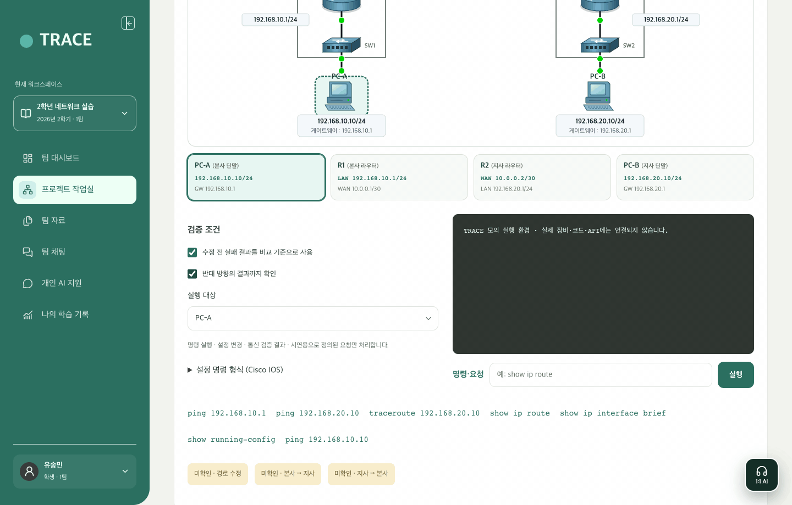
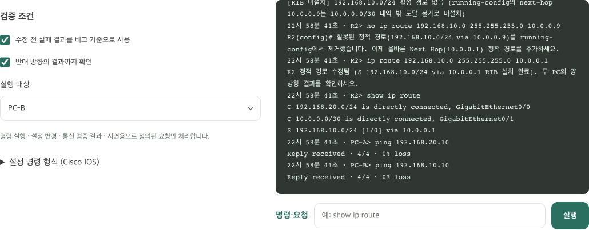
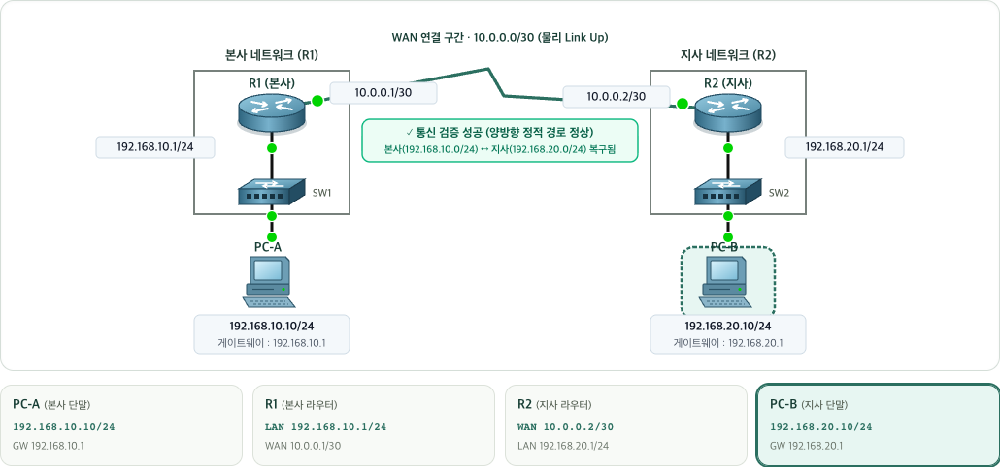
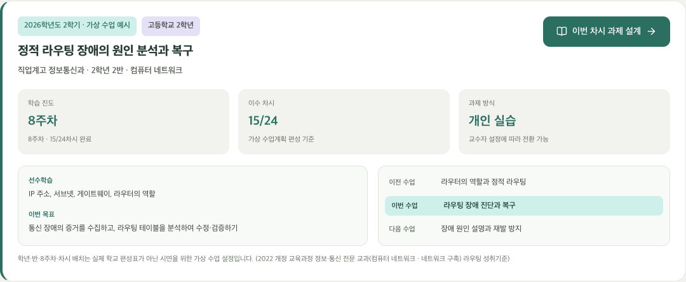
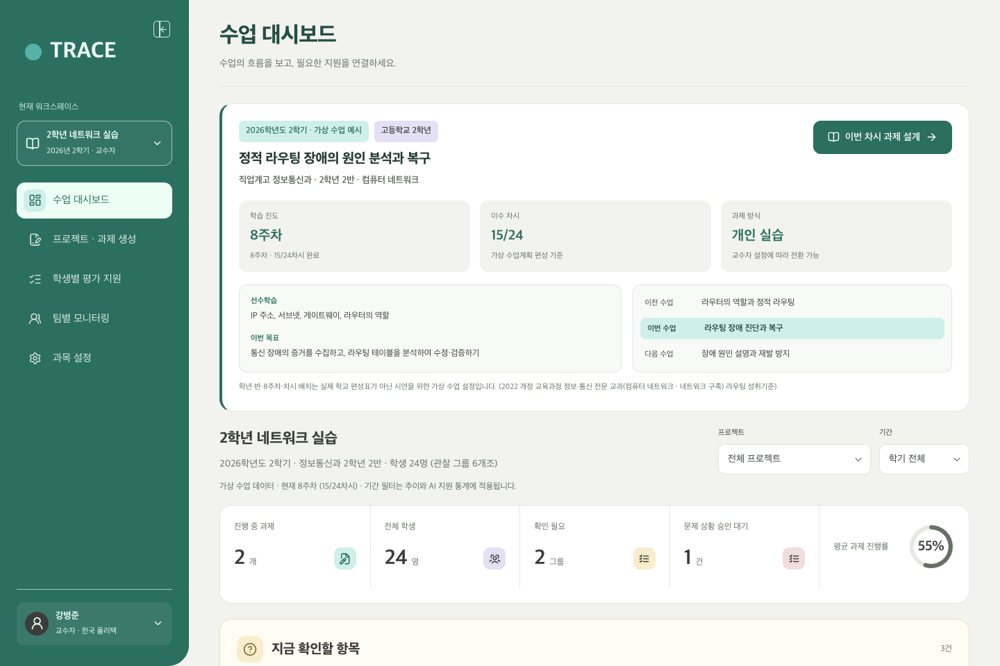
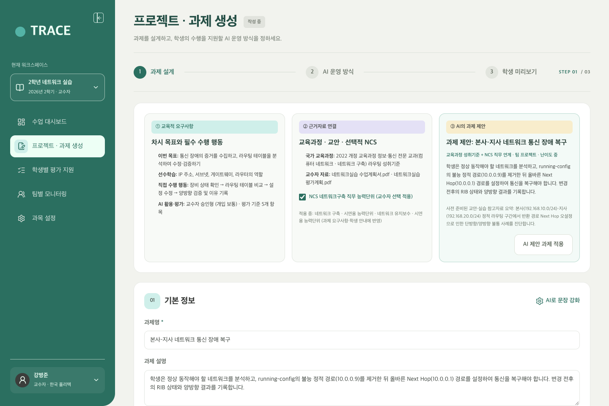
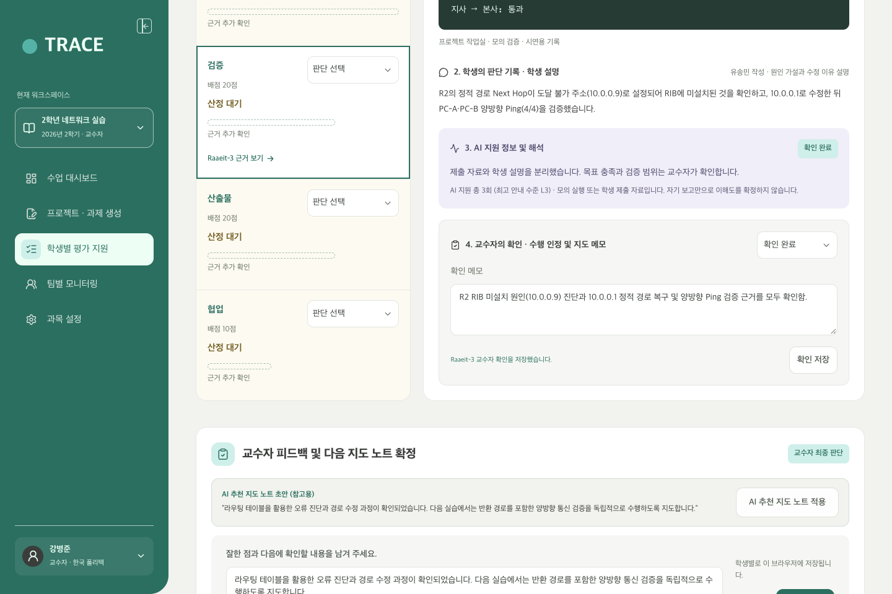

# TRACE 7분 발표 및 3분 시연(HOW) PPT 스토리보드·대본 가이드

7분 발표 중 **3분 시연 구간(`HOW ① ~ ④`)** 에 바로 복사해 넣을 수 있는 **움짤(GIF) · 부분 확대 이미지(PNG) · 발표 대본**을 슬라이드 순서대로 정리한 문서입니다.

---

## 한눈에 보는 7분 발표 타임라인

| 구간 | 시간 | 슬라이드 주제 | 핵심 메시지 | 주요 시각 자료 |
| :--- | :--- | :--- | :--- | :--- |
| **도입 (WHY)** | `0:00–2:10` (2분 10초) | 문제제기 · 적용 교과 · TRACE 구조 | 정답만 요구하는 AI 사용 습관과 결과물 중심 평가의 한계를 **교수자 정책 → AI 코칭 → 실습 검증 → 학습 증거** 구조로 해결 | 기존 PPT 앞부분 (1~4슬라이드) |
| **HOW ①** | `2:10–2:50` (40초) | **학생의 문제 직면과 1:1 AI 코칭** | 학생이 정답 명령어를 요구해도 AI는 1초 생각 후 **정답을 유보**하고 게이트웨이·라우팅 점검 순서를 질문 | `gif-02a` + `03a`, `03b`, `03c` |
| **HOW ②** | `2:50–3:40` (50초) | **학생의 CLI 진단·복구·양방향 검증** | `show running-config`·`show ip route` 비교로 오설정(`10.0.0.9`)을 찾아 **`no ip route` 제거 → `10.0.0.1` 복구 → 양방향 Ping** 수행 | `gif-03` + `04a`, `04b`, `04c` |
| **HOW ③** | `3:40–4:25` (45초) | **교수자의 과제 및 AI 정책 설계** | 2022 개정 교육과정(고2 컴퓨터 네트워크 8주차) 기반 과제 제안 시 **학생 공개 안내와 교수자 전용 정답을 분리**하고 4단계 AI 지원 정책 설정 | `01a`, `02a`, `02b` |
| **HOW ④** | `4:25–5:05` (40초) | **4단 학습 증거 기반 교수자 평가** | **① CLI 원자료 + ② 학생 판단 근거**와 **③ AI 개입 요약 + ④ 교수자 수행 인정·지도 메모**를 대조해 과정 중심 평가 완료 | `05a`, `06a1`, `06a2`, `06b` |
| **정리** | `5:05–7:00` (1분 55초) | 교육과정 대응표 · 차별성 · 확장 방향 | 일반 챗봇·LMS 대비 차별점, 규칙 기반 프로토타입의 검증 범위 및 타 실습 교과 확장성 제시 | 하단 3·4장 표 활용 |

---

## 슬라이드 1 (`HOW ①` · 40초): 학습자 직면 문제 — 정답 요구를 스스로 탐색으로 전환

### 🎤 발표 대본 (40초)
> "먼저 학생이 실습 중 마주하는 장면입니다. 본사 `PC-A`에서 지사 `PC-B`로 통신이 되지 않자, 학생은 우측 하단 **1:1 개인 AI 지원** 창을 열어 *'통신이 안 되는데 정답 명령어를 바로 알려달라'* 고 요청합니다.  
> 일반 생성형 AI라면 즉시 `ip route` 정답을 출력하겠지만, TRACE의 AI는 잠시 학습 맥락을 확인한 뒤 **정답 명령어를 유보**하고 기본 게이트웨이 Ping과 라우팅 테이블 중 무엇부터 확인해야 할지 탐색 순서를 먼저 질문합니다.  
> 이어서 학생이 게이트웨이까지는 응답이 오지만 지사 PC가 실패한다고 답하면, AI는 **반대 방향인 R2의 반환 경로와 Next Hop 도달 가능성**을 스스로 점검하도록 유도합니다."

### 🎬 슬라이드 메인 애니메이션 (GIF)

### 🖼️ 슬라이드 부분 확대 컷 (PNG)

#### ① 물리 Link Up vs 논리 End-to-End 통신 실패 토폴로지 (`03a`)

#### ② 1:1 개인 AI 지원 단계별 응답 (`03b0` · `03b` · `03c`)

| AI 답변 준비 중 (`03b0`) | 1차 질문: 탐색 순서 안내 (`03b`) | 2차 질문: R2 반환 경로 질문 (`03c`) |
| :---: | :---: | :---: |
|  |  |  |
| 질문 직후 1초간 학습 맥락·실습 상태를 확인하는 애니메이션 | 정답 명령어를 바로 주지 않고 게이트웨이(`192.168.10.1`) 응답 여부부터 질문 | `PC-A → R1` 정상 확인 후 반대 방향(`R2`) 반환 경로와 Next Hop 도달 가능성 질문 |

전체 화면 캡처 및 전체 화면 GIF 보기 (보조 자료)

- **학생 실습실 + 1:1 AI 팝오버 전체 화면 (`03-student-lab-full.png`)**
  
- **학생 실습실 전체 화면 코칭 GIF (`gif-02-student-ai-coaching.gif`)**
  

---

## 슬라이드 2 (`HOW ②` · 50초): 학생의 판단·복구·검증 — CLI 원자료와 논리 통신 복구

### 🎤 발표 대본 (50초)
> "AI의 안내에 따라 학생은 스스로 CLI 진단을 수행합니다.  
> `R2`에서 `show running-config`와 `show ip route`를 비교해 본 결과, 물리적인 WAN 링크는 정상이지만 정적 경로의 Next Hop이 `10.0.0.0/30` 대역 밖인 `10.0.0.9`로 잘못 설정되어 활성 라우팅 테이블(RIB)에 설치되지 않은 원인을 찾아냅니다.  
> 학생은 실제 Cisco IOS 절차에 따라 `no ip route 192.168.10.0 255.255.255.0 10.0.0.9`로 잘못된 경로를 제거하고, `10.0.0.1`로 정적 경로를 다시 설정한 뒤 `show ip route`와 `PC-A`, `PC-B` 양방향 Ping 성공을 검증합니다.  
> 마지막으로 왜 그렇게 판단했는지 자신의 언어로 기록하면, 실행 로그와 판단 근거가 하나의 학습 증거로 저장됩니다."

### 🎬 슬라이드 메인 애니메이션 (GIF)

### 🖼️ 슬라이드 부분 확대 컷 (PNG)

#### ① CLI 진단·제거(`no ip route`)·복구(`ip route`)·양방향 Ping 검증 로그 (`04a`)

| ② 복구 완료 후 논리 통신 성공 토폴로지 (`04b`) | ③ 학생의 판단 근거 작성 및 증거 기록 (`04c`) |
| :---: | :---: |
|  |  |
| 중앙 상태 배지가 **`✓ 통신 검증 성공 (양방향 정적 경로 정상)`** 으로 전환 | `running-config`와 `RIB` 비교 근거 및 양방향 Ping 검증 내용을 학생 스스로 서술 |

---

## 슬라이드 3 (`HOW ③` · 45초): 교수자의 과제·AI 정책 설계 — 왜 AI가 정답을 멈추었는가

### 🎤 발표 대본 (45초)
> "그렇다면 앞선 장면에서 AI는 왜 정답을 바로 주지 않았을까요? 교수자가 수업을 시작할 때 설계한 **과제 구조와 AI 운영 정책** 때문입니다.  
> 본 시연은 2022 개정 교육과정이 적용되는 고등학교 2학년 「컴퓨터 네트워크」 8주차 개인 실습 수업으로 설정했습니다.  
> 교수자가 교육과정 성취기준과 NCS 직무 요소를 선택하면 AI가 실습 과제를 제안하는데, 이때 **학생에게 공개되는 과제 안내문**에는 장애 증상과 검증 목표만 제시되고, 주입한 오류(`10.0.0.9`)와 복구 정답(`10.0.0.1`)은 **교수자 전용 기준**으로 분리됩니다.  
> 또한 교수자가 AI 지원 범위를 확인 질문과 탐색 힌트 중심으로 설정했기 때문에, 학생 화면의 AI가 정답 제시를 멈추고 코칭을 수행한 것입니다."

### 🖼️ 슬라이드 부분 확대 컷 (PNG)

#### ① 2026학년도 2학기 고2 「컴퓨터 네트워크」 8주차 수업 배너 (`01a`)

#### ② 교육과정 + NCS 연계 AI 과제 제안 — 학생 안내와 교수자 전용 정답 분리 (`02a`)

#### ③ 교수자 AI 운영 방식 및 4단계 지원 수준 설정 (`02b`)

교수자 설계 전체 화면 및 GIF 보기 (보조 자료)

- **교수자 과제 설계 및 정책 설정 GIF (`gif-01-teacher-setup.gif`)**
  
- **교수자 대시보드 전체 화면 (`01-dashboard-full.png`)**
  
- **교수자 과제 설계 전체 화면 (`02-assignment-full.png`)**
  

---

## 슬라이드 4 (`HOW ④` · 40초): 학습 증거 기반 평가 — 4단 학습 증거 2분할 확인

### 🎤 발표 대본 (40초)
> "마지막으로 교수자의 학습 증거 평가 화면입니다.  
> 교수자는 개별 학생 관찰 표에서 각 학생이 어느 단계에 머물러 있는지와 AI 지원 요약 신호를 한눈에 파악합니다.  
> 유송민 학생의 학습 증거를 열면, 좌측(상단)에는 **① 학생이 실제로 실행한 CLI 명령·출력 원자료**와 **② 학생 자신이 작성한 판단 근거**가 제시되고, 우측(하단)에는 **③ AI가 어떤 힌트 수준으로 개입했는지 요약 정보**와 **④ 교수자의 최종 수행 인정 및 지도 메모**가 나란히 놓입니다.  
> 즉, 교수자는 단순 결과 파일이 아니라 *'학생이 어떤 AI 지원을 받아 스스로 문제를 해결했는가'* 를 검증하여 평가를 마무리합니다."

### 🖼️ 슬라이드 부분 확대 컷 (16:9 슬라이드 배치용 2분할 PNG)

#### ① 학생별 진행 상태와 개입 신호 관찰 표 (`05a`)

| ② 학습 증거 전반부: 학생 실행 원자료 + 학생 판단 기록 (`06a1`) | ③ 학습 증거 후반부: AI 지원 요약 + 교수자 확인·메모 (`06a2`) |
| :---: | :---: |
|  |  |
| **① 실제 실행 기록(원자료)** (`show running-config`, `no ip route`, 양방향 `ping`) + **② 학생의 판단 기록** | **③ AI 지원 정보 및 해석**(질문 2회 · 탐색 방향 안내) + **④ 교수자의 확인 완료 및 지도 메모** |

#### ④ AI 추천 지도 노트 및 최종 피드백 (`06b`)

교수자 평가 전체 화면 및 GIF 보기 (보조 자료)

- **교수자 학습 증거 검토 및 평가 완료 GIF (`gif-04-teacher-evidence-review.gif`)**
  
- **교수자 학생별 평가 전체 화면 (`06-evaluation-full.png`)**
  

---

## 3. 교육과정 목표 ↔ 학생 수행 증거 ↔ 교수자 확인 대응표

발표 후반부(차별성 정리 슬라이드)에 바로 넣을 수 있는 요약표입니다.

| 교육과정·수업 설계 목표 (교수자 설정) | 학생 수행 증거 (원자료 + 판단 기록) | AI 지원·해석 요약 | 교수자 최종 확인 기준 |
| :--- | :--- | :--- | :--- |
| **장애 구간 분리** End-to-End 통신 실패 시 LAN 구간과 원격 구간을 구분 | `PC-A> ping 192.168.10.1` (성공) `PC-A> ping 192.168.20.10` (100% loss) | **확인 질문 / 탐색 방향 안내** 정답 명령어 유보, 게이트웨이·라우팅 테이블 점검 순서 유도 | 기본 게이트웨이 정상 여부를 먼저 확인해 장애 범위를 좁혔는가 |
| **라우팅 설정과 RIB 비교 분석** 설정된 정적 경로와 실제 활성 경로의 차이 파악 | `R2> show running-config` `R2> show ip route` (`10.0.0.9` 도달 불가로 RIB 미설치 확인) | **개념 힌트** 왕복 통신 조건 및 R2 반환 경로의 Next Hop 도달 가능성 질문 | `running-config`의 오설정 경로가 왜 `show ip route`(RIB)에 올라오지 않는지 설명했는가 |
| **정적 경로 수정 및 양방향 검증** 오류 경로 제거 후 올바른 Next Hop 설정·검증 | `R2> no ip route ... 10.0.0.9` `R2> ip route ... 10.0.0.1` `PC-A`·`PC-B` 양방향 `ping` (0% loss) | **도구 활용 힌트** 수정 전후 명령 비교 및 양방향 검증 체크리스트 연동 | `no ip route` 제거 후 `10.0.0.1` 복구 및 양방향 Ping 성공을 모두 입증했는가 |

---

## 4. 프로토타입 구현 범위 및 심사위원 예상 Q&A

### 4-1. 정직한 구현 범위 안내 (발표 시 권장 표현)
- 본 데모는 **교수자의 AI 정책 설정 → 학생 맞춤형 코칭 → CLI 실습 검증 → 4단 학습 증거 수집·평가**로 이어지는 교육모델의 작동 구조를 검증하기 위해 제작한 **규칙 기반(Rule-based) 인터랙티브 프로토타입**입니다.
- 시연 중 제시되는 AI 응답과 CLI 출력은 직업계고 네트워크 실습 시나리오에 맞춰 구조화된 시뮬레이션 응답이며, 향후 실제 LLM API 및 실습 장비(Packet Tracer / GNS3 등) 로그 수집 파이프라인으로 확장할 수 있도록 도메인 계층(`src/domain/`)을 분리해 설계했습니다.

### 4-2. 심사위원 예상 질문 및 답변 가이드

| 예상 질문 | 핵심 답변 요약 |
| :--- | :--- |
| **Q1. 일반 ChatGPT를 쓰는 것과 무엇이 다른가요?** | 일반 챗봇은 학생이 물으면 정답 명령어(`ip route ...`)를 바로 출력해 실습 목적을 무너뜨립니다. TRACE는 **교수자가 설정한 차시 목표와 지원 단계 정책**에 따라 정답을 유보하고, 학생의 현재 CLI 실습 상태에 맞춘 확인 질문과 탐색 힌트를 제공합니다. |
| **Q2. 교수자가 학생의 AI 대화 전문을 일일이 다 읽어야 하나요?** | 아닙니다. 학생에게는 평가 부담을 주지 않도록 지원 단계 라벨(`L1~L4`)을 숨기되, 교수자에게는 대화 원문 전체 대신 **지원 수준 분포와 핵심 개입 요약**을 실행 로그·학생 설명과 함께 4단 카드로 압축해 보여줍니다. |
| **Q3. 왜 물리 링크는 초록색인데 통신 실패라고 표시되나요?** | 실제 라우팅 장애 교육에서 가장 중요한 구분이 **물리 계층(Link Up)과 네트워크 계층(라우팅 테이블 미설치)의 분리**이기 때문입니다. 케이블과 인터페이스는 정상(초록 LED)이지만 잘못된 Next Hop(`10.0.0.9`) 때문에 논리 경로가 끊긴 상황을 정확히 표현했습니다. |
| **Q4. 네트워크 외에 다른 교과에도 적용 가능한가요?** | 네. 코드 구조상 교과 데이터·시뮬레이션(`src/domain/`)과 학습 워크스페이스·증거 구조(`src/features/`)를 분리했습니다. 동일한 4단 학습 증거 구조(실행 원자료 + 학생 판단 + AI 지원 요약 + 교수자 확인)를 프로그래밍, 과학 실험, IoT 융합 실습에 그대로 적용할 수 있습니다. |
